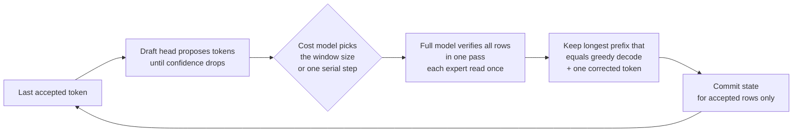

# Metodología: cómo medimos, qué significa "exacto" y cómo se cualifica un valor predeterminado

[English](methodology.md) · [Español](methodology.es.md) · [README principal](../README.es.md)

Cada velocidad del README y de las páginas de los modelos se mide en el laboratorio con decodificación greedy
(temperatura 0), en la compilación que indica la fila, con el prompt, el contexto, la concurrencia y el número de
repeticiones declarados. Esta página explica cómo se leen las tablas, qué cubre la exactitud en cada motor, cómo se
mide la fidelidad del modelo, cómo funcionan los valores predeterminados y sus interruptores de desactivación, y qué
decisiones de diseño dan forma al motor. Los registros fechados están en [rendimiento](performance.md); los
comandos e interfaces de máquina para reproducirlos, en [reproducción](reproduce.md); la evidencia por palanca,
en el [catálogo de optimizaciones](optimizations.md).

<a id="how-fast"></a>

## Cómo leer las tablas

Use el [kit de benchmarks y la guía de reproducción](reproduce.md) para obtener los comandos actuales, los requisitos de los modelos, las interfaces para máquinas y los informes listos para abrir incidencias.

Todas las velocidades siguientes se miden en el laboratorio con decodificación greedy (temperatura 0). La exactitud es relativa al
perfil numérico indicado; la división del pipeline RTX con trellis y el decode R1b de GLM tienen identidades propias, como
se indica más abajo. Los techos de ancho de banda son cotas calculadas, no rendimiento medido. Las pruebas, los métodos y los valores anteriores están en
**[docs/performance.md](performance.md)**.

Cómo leer las tablas:

- **Mejor** es el mejor resultado medido para ese modo, en la carga de trabajo que más le conviene (normalmente código o
  texto con mucha copia). **Típico** es el mismo modo con texto corriente, para saber qué esperar de un chat general.
- **tok/s** es la velocidad de decode una vez leído el prompt, para una petición salvo que la concurrencia indique
  otra cosa. **TTFT** es el tiempo hasta el primer token.
- **Build** identifica la revisión del código medida; los resultados se aplican a esa compilación y configuración.
  Los metadatos de calendario y la procedencia completa se conservan en los registros de rendimiento enlazados.
- El número de repeticiones se indica cuando se registró. No debe suponerse que los recuentos no especificados son medianas;
  las ejecuciones únicas y las campañas separadas siguen etiquetadas.

Hardware: **1 nodo** = un Strix Halo (128 GB). **2 nodos** = dos Strix Halo unidos por dos cables USB4.
**RTX PRO** = una RTX PRO 6000 Blackwell (96 GB) en un PC con 1 GbE.

<a id="how-exact-how-good"></a>
<a id="exactness"></a>

## Exactitud

Todos los motores son exactos por defecto **respecto a su ruta de referencia declarada**: IDs de token idénticos para los
mismos assets de modelo, par de perfiles numéricos, prompt/estado y política de selección. La exactitud es independiente
de la decodificación especulativa y de la concurrencia. El drafting cambia cómo se propone el trabajo; el batching, el anidamiento,
la restauración de prefijos y las réplicas cambian cuándo se ejecuta. Sus gates deben preservar la secuencia completa
y el estado confirmado de cada petición respecto a su referencia.

El interruptor de desactivación de una optimización restaura su ruta de ejecución anterior. Un interruptor de línea base o de identidad
también puede cambiar la aritmética: conserve el modelo, el perfil, la capacidad y el estado al comprobar la igualdad.
El prefill FP16 de Qwen tiene su propia referencia; GLM R1b tiene su propia identidad de decode; YaRN tiene su propia identidad
rotatoria. Ninguna implica igualdad con una identidad distinta ni con pesos de precisión completa.

Estas salidas se comprueban token a token (o byte a byte) frente a una referencia correspondiente:

- El decode especulativo MTP de Qwen es igual al decode greedy serial con el mismo perfil numérico, bit a bit
  (error de repetición golden 0 en todas las ejecuciones cronometradas; réplicas 570/570 iguales a un nodo). El decode
  MTP con muestreo es exacto en distribución (la misma distribución de salida que el decode serial con muestreo), pero no
  idéntico al serial: con la misma semilla, sus tokens pueden diferir de los de una ejecución serial con muestreo.
- El prefill por tiles de Qwen y la puntuación con teacher forcing preservan la referencia de su perfil declarado; la ruta automática
  de prefill FP16 rápido no es igualdad de bits con el serial A8 denso.
- DeepSeek en el par: las ventanas greedy y DSpark son iguales a las referencias almacenadas en ambos ranks; los tokens de batch y
  64/64 respuestas del servidor son iguales a las referencias de la campaña.
- DeepSeek dividido con la RTX PRO: igual bit a bit al par sin los sitios trellis (24/24 prompts). Con ellos
  es una identidad compuesta declarada (KL 1.7e-3 frente al par), no bit a bit.

- Los gates de MiniMax comparan logits golden, decode/verificación e intercambio; GLM usa gates G3/G4, de identidad,
  de logits de prefill y de oráculo especulativo en ambos ranks. El MTP de GLM coincide con `--mtp 0`.
- El MTP con YaRN de Qwen tiene pruebas de igualdad completas a 262K y 1M y pruebas de alcance objetivo a 524K frente a
  YaRN serial; estos resultados no establecen igualdad con la rotatoria nativa ni calidad general en contexto largo.
  [Alcance de la cualificación](optimizations.md#qwen-yarn-mtp).

El [kit de benchmarks](reproduce.md) está disponible. En el hardware de ejecución, inspeccione la disponibilidad y
ejecute la suite de exactitud con una clave de motor indicada por `list`:

```sh
bash scripts/bench/bench.sh list
bash scripts/bench/bench.sh check --engine E --only exactness --suite quick --json
bash scripts/bench/bench.sh run --engine E --only exactness --suite quick --json
```

`EXACT`, `MISMATCH` y `NO-REFERENCE` son veredictos distintos. La falta de datos de referencia no cuenta como superado.
Las pruebas de CPU y la inspección de la configuración no cualifican la ejecución nativa.

<a id="how-it-works"></a>

### Por qué la decodificación especulativa sigue siendo exacta

**Un ciclo de decode especulativo** (el MTP de Qwen y el DSpark de DeepSeek siguen la misma forma):



Un paso de un token está limitado por el ancho de banda de memoria (se leen todos los pesos activos para un token), así que comprobar 4 u 8
tokens cuesta mucho menos que 4 u 8 pasos. El servicio por batch va un paso más allá: las ventanas conjuntas verifican juntas las filas de
varias peticiones, leyendo cada peso una sola vez para todas ellas.

## Fidelidad del modelo

**La calidad se mide, no se supone.** Un arnés con teacher forcing compara la distribución de salida completa del motor con
una referencia en cada posición (divergencia KL y concordancia top-1), por categoría e idioma.

| Perfil de Qwen | KL respecto a la referencia Q8_0 | Concordancia top-1 |
|---|---|---|
| Exacto (FP32 denso) | 0.01940 | 95.52 % |
| A8 denso (recomendado) | 0.01978 (+1.9 ± 2.0 %) | 95.55 % |

49,001 posiciones ([D-032](decisions/decision-register.md#d-032-dense-a8-in-the-recommended-profile)): el A8 denso está tan cerca de la
referencia como el perfil exacto, dentro del margen entre dos implementaciones exactas de los mismos pesos. Donde los
dos perfiles discrepan (2.8 % de las posiciones), casi siempre es entre candidatos casi iguales.

Para DeepSeek, los pesos densos codificados con trellis (mix-B) están tan cerca del modelo de precisión original como el formato
de 6.5 bits (KL 0.0446 frente a 0.0447 sobre 103,908 tokens) con 2.27 en lugar de 3.63 GB leídos por token y por nodo; esto se
calculó en una emulación de los formatos, no con los kernels del motor.

Metodología: [docs/engine/prefill/teacher-forced-tiled-prefill.md](engine/prefill/teacher-forced-tiled-prefill.md),
[docs/engine/decode/optimization-profile.md](engine/decode/optimization-profile.md),
[docs/reference/qualification-ledger.md](reference/qualification-ledger.md).

<a id="defaults-and-off-switches"></a>

## Valores predeterminados e interruptores de desactivación

Empiece con el comando simple del motor seleccionado. Las optimizaciones de producción están **ACTIVADAS por defecto**
cuando se superan sus protecciones de modelo, forma, recursos y referencia. Los flags de organización opt-in heredados pueden asumir
la selección de ruta y rechazar la ruta automática. Los assets obligatorios, los argumentos de rank y las políticas
numéricas explícitas siguen formando parte del contrato de lanzamiento.

| Motor | Inspeccionar antes del trabajo en el dispositivo | Línea base maestra |
|---|---|---|
| Qwen | `--print-effective-config` | `--baseline` / `STRIX_BASELINE=1` |
| Par DeepSeek | `--print-effective-config` | `STRIX_DS41_BASELINE=1` |
| DeepSeek RTX | `--print-config` | `--baseline` / `STRIX_DS41_RTX_BASELINE=1` |
| MiniMax | `--print-effective-config` | `STRIX_MM_BASELINE=1` |
| GLM | `--print-effective-config` | `--baseline` / `STRIX_GLM_BASELINE=1` |

Añada la inspección al comando normal del motor, conservando los assets obligatorios y los argumentos de rank.
La inspección termina antes de la ejecución en el dispositivo. La ejecución de Qwen también emite un registro JSON `strix-build-info` y uno
`strix-startup-event` en stderr; los campos informativos no son fallos. `STRIX_RELEASE_EVENTS=0`
desactiva ambos. [Preflight de arranque e identidad de compilación](operations/startup-preflight.md).

Use el interruptor de desactivación de un solo elemento cada vez para A/B. Reinicie los lectores con caché en el arranque y ambos ranks según sea necesario,
compare primero los tokens completos y los digests de logits/estado, y después las medianas de tiempos intercalados. Las líneas base
maestras tienen un alcance específico de cada motor y pueden cambiar la aritmética; no son una forma universal de mantener
fija la referencia. Véanse [precedencia, protecciones y alternativas](optimizations.md#baselines-inspection-and-exactness)
y el [catálogo JSON](optimizations.json).

Los valores predeterminados de arranque y teselado específicos de Qwen y el registro de opciones de prefill que cambian
bits están en la [página de Qwen](models/qwen3.8/README.es.md#bit-changing-prefill-options). El registro de cambios
de cada valor predeterminado incorporado con su ganancia medida y su interruptor de desactivación es
[ganancias medidas](measured-gains.es.md).

<a id="why-it-is-different"></a>

## Principios

- **Decodificación especulativa exacta.** La cabeza MTP de Qwen y el drafter DSpark de DeepSeek proponen varios tokens; el modelo
  completo los comprueba en una pasada y conserva la secuencia correcta más larga. Los kernels multifila repiten la aritmética de una fila,
  así que una suposición errónea cuesta tiempo, nunca corrección.
- **Varias formas de aprovechar más hardware, cada una medida.** Ventanas de verificación por batch en un nodo, una réplica por nodo,
  un modelo dividido entre dos nodos sobre USB4 (paralelismo tensorial de expertos) y una GPU discreta para las primeras capas o
  el prompt.
- **Perfiles numéricos con nombre y calidad medida.** El redondeo es una elección con nombre y versionada. El prompt puede leerse
  con un perfil y la respuesta escribirse con otro (D-033).
- **Valores predeterminados rápidos con pruebas explícitas.** Las optimizaciones de producción están activadas cuando se superan sus protecciones de admisión;
  use los interruptores de desactivación para A/B. El catálogo distingue entre pruebas de operadores, exactitud nativa y mediciones
  en cargas de trabajo completas. Las propuestas de draft y las ganancias de kernels aisladas no establecen una nueva afirmación de velocidad de producción.
- **AMD primero e independiente.** Los kernels, la planificación, la decodificación especulativa, el lector GGUF, el planificador de memoria y el
  comunicador de dos nodos son código propio; el motor no envuelve otro runtime de inferencia. ROCm/HIP, Linux, el
  formato GGUF y las herramientas de compilación habituales siguen siendo dependencias. El motor sigue siendo plenamente utilizable en un único Strix Halo;
  el funcionamiento multinodo y otras GPU son etapas separadas y cualificadas explícitamente.

<a id="design-decisions"></a>

## Decisiones de diseño

El registro completo, con alternativas, pruebas y la condición para reabrir cada una, está en
[docs/decisions/decision-register.md](decisions/decision-register.md). Las principales:

- **Verificación exacta en lugar de tolerancia (D-021)** y **ventanas adaptativas 2/4/8 con un modelo de coste en línea (D-022)**.
- **Perfiles numéricos con nombre (D-024, D-032)** y **un perfil de prefill separado (D-033)**.
- **Prefill por tiles con bytes idénticos (D-034)**: una ejecución de puntuación de 16K tokens pasó de 1001 s a 66 s.
- **Servicio: reinicio del controlador por petición (D-057), ventanas conjuntas para peticiones concurrentes (D-058), dos réplicas completas
  tras el router (D-060)**: C4 +8-9 %, y C6/C8 ya escalan más allá de C4.
- **Valores predeterminados de DeepSeek en dos nodos (D-061), transporte acotado con envíos pequeños anticipados y staging fusionado (D-062),
  intercambio directo desde la GPU (D-063), una GPU discreta en el decode (D-064, opt-in).**
- **Medido y descartado:** la captura con hipGraph del bucle de decode, el paralelismo tensorial de una petición de Qwen entre los
  nodos (X-021) y más; cifras en la
  [tabla de descartes](decisions/decision-register.md#measured-and-rejected).

El trabajo de cualificación e ingeniería pendiente está registrado con su alcance en el
[estado de la implementación](reference/implementation-status.md), el
[catálogo de optimizaciones](optimizations.md) y el [registro de decisiones](decisions/decision-register.md).
El éxito del compilador, las estimaciones de memoria y el rendimiento teórico no cierran esas puertas.
