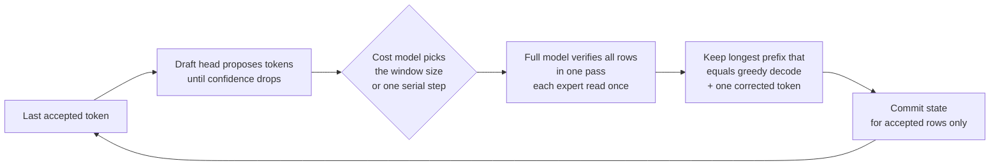

# Methodology: how we measure, what "exact" means and how a default is qualified

[English](methodology.md) · [Español](methodology.es.md) · [Main README](../README.md)

Every speed in the README and the model pages is measured in the lab with greedy decoding (temperature 0), on the
build named in the row, with the stated prompt, context, concurrency and repetition count. This page explains how the
tables are read, what exactness covers for each engine, how model fidelity is measured, how defaults and their off
switches work, and which design decisions shape the engine. The dated records are in
[performance](performance.md); commands and machine interfaces to reproduce them are in
[reproduce](reproduce.md); the per-lever evidence is in the [optimization catalog](optimizations.md).

<a id="how-fast"></a>

## How to read the tables

Use the [benchmark kit and reproduction guide](reproduce.md) for current commands, model requirements, machine interfaces and issue-ready reports.

Every speed below is measured in the lab with greedy decoding (temperature 0). Exactness is relative to the
named numerical profile; the trellis RTX pipeline split and GLM R1b decode have separate identities, as
noted below. Bandwidth ceilings are calculated bounds, not measured throughput. Evidence, methods and older values are in
**[docs/performance.md](performance.md)**.

How to read the tables:

- **Best** is the best measured result for that mode, on the workload that suits it most (usually code or
  copy-heavy text). **Typical** is the same mode on ordinary text, so you know what to expect from a general chat.
- **tok/s** is decode speed after the prompt has been read, for one request unless the concurrency says
  otherwise. **TTFT** is time to first token.
- **Build** identifies the measured code revision; results apply to that build and configuration.
  Calendar metadata and complete provenance remain in the linked performance records.
- Repetition counts are stated where recorded. Unspecified counts must not be assumed to be medians;
  single runs and separate campaigns remain labeled.

Hardware: **1 node** = one Strix Halo (128 GB). **2 nodes** = two Strix Halo joined by two USB4 cables.
**RTX PRO** = an RTX PRO 6000 Blackwell (96 GB) in a PC on 1 GbE.

<a id="how-exact-how-good"></a>
<a id="exactness"></a>

## Exactness

All engines are exact by default **to their declared reference path**: identical token IDs for the
same model assets, numerical profile pair, prompt/state and selection policy. Exactness is independent
of speculative decoding and concurrency. Drafting changes how work is proposed; batching, nesting,
prefix restore and replicas change when it runs. Their gates must preserve each request's complete
sequence and committed state relative to its reference.

An optimization's off switch restores its previous execution path. A baseline or identity switch
can also change arithmetic: preserve the model, profile, capacity and state when testing equality.
FP16 Qwen prefill has its own reference; GLM R1b has its own decode identity; YaRN has its own rotary
identity. None implies equality to a different identity or full-precision weights.

These outputs are checked token for token (or byte for byte) against a matching reference:

- Qwen MTP speculative decoding equals serial greedy decode with the same numerical profile, bit for bit
  (golden replay error 0 on every timed run; replicas 570/570 equal to one node). Sampled MTP decode is
  distribution-exact (the same output distribution as sampled serial decode) but not serial-identical: with
  the same seed its tokens can differ from those of a sampled serial run.
- Qwen tiled prefill and teacher-forced scoring preserve their declared profile reference; the automatic
  fast FP16 prefill path is not dense-A8 serial bit equality.
- DeepSeek on the pair: greedy and DSpark windows equal the stored references on both ranks; batch tokens and
  64/64 server responses equal the campaign references.
- DeepSeek split with the RTX PRO: bitwise equal to the pair without the trellis sites (24/24 prompts). With them
  it is a declared composed identity (KL 1.7e-3 against the pair), not bitwise.

- MiniMax gates compare golden logits, decode/verify and exchange; GLM uses G3/G4, identity,
  prefill-logit and speculative-oracle gates on both ranks. GLM MTP matches `--mtp 0`.
- Qwen YaRN MTP has full 262K and 1M equality evidence and target-scope 524K evidence against
  serial YaRN; these results do not establish native-rotary equality or general long-context quality.
  [Qualification scope](optimizations.md#qwen-yarn-mtp).

The [benchmark kit](reproduce.md) is present. On the execution hardware, inspect availability and
run the exactness suite with an engine key reported by `list`:

```sh
bash scripts/bench/bench.sh list
bash scripts/bench/bench.sh check --engine E --only exactness --suite quick --json
bash scripts/bench/bench.sh run --engine E --only exactness --suite quick --json
```

`EXACT`, `MISMATCH` and `NO-REFERENCE` are distinct verdicts. Missing reference data is not a pass.
CPU tests and config inspection do not qualify native execution.

<a id="how-it-works"></a>

### Why speculative decoding stays exact

**One speculative decode cycle** (Qwen's MTP and DeepSeek's DSpark follow the same shape):



A one-token step is limited by memory bandwidth (all active weights are read for one token), so checking 4 or 8
tokens costs far less than 4 or 8 steps. Batched serving goes one step further: joint windows verify the rows of
several requests together, reading each weight once for all of them.

## Model fidelity

**Quality is measured, not assumed.** A teacher-forced harness compares the engine's full output distribution with
a reference at every position (KL divergence and top-1 agreement), per category and language.

| Qwen profile | KL to Q8_0 reference | Top-1 agreement |
|---|---|---|
| Exact (FP32 dense) | 0.01940 | 95.52 % |
| Dense A8 (recommended) | 0.01978 (+1.9 ± 2.0 %) | 95.55 % |

49,001 positions ([D-032](decisions/decision-register.md#d-032-dense-a8-in-the-recommended-profile)): dense A8 is as close to the
reference as the exact profile, within the margin between two exact implementations of the same weights. Where the
two profiles disagree (2.8 % of positions) it is almost always between near-equal candidates.

For DeepSeek, the trellis-coded dense weights (mix-B) are as close to the original-precision model as the 6.5-bit
format (KL 0.0446 against 0.0447 over 103,908 tokens) at 2.27 instead of 3.63 GB read per token per node; this was
computed in an emulation of the formats, not with the engine's kernels.

Methodology: [docs/engine/prefill/teacher-forced-tiled-prefill.md](engine/prefill/teacher-forced-tiled-prefill.md),
[docs/engine/decode/optimization-profile.md](engine/decode/optimization-profile.md),
[docs/reference/qualification-ledger.md](reference/qualification-ledger.md).

<a id="defaults-and-off-switches"></a>

## Defaults and off switches

Start with the plain command for the selected engine. Production optimizations are **ON by default**
when their model, shape, resource and reference guards pass. Legacy opt-in organization flags can take
over route selection and decline the automatic path. Required assets, rank arguments and explicit
numerical policies remain part of the launch contract.

| Engine | Inspect before device work | Master baseline |
|---|---|---|
| Qwen | `--print-effective-config` | `--baseline` / `STRIX_BASELINE=1` |
| DeepSeek pair | `--print-effective-config` | `STRIX_DS41_BASELINE=1` |
| DeepSeek RTX | `--print-config` | `--baseline` / `STRIX_DS41_RTX_BASELINE=1` |
| MiniMax | `--print-effective-config` | `STRIX_MM_BASELINE=1` |
| GLM | `--print-effective-config` | `--baseline` / `STRIX_GLM_BASELINE=1` |

Add inspection to the engine's normal command, retaining required assets and rank arguments.
Inspection exits before device execution. Qwen execution also emits one `strix-build-info` and one
`strix-startup-event` JSON record on stderr; advisory fields are not failures. `STRIX_RELEASE_EVENTS=0`
disables both. [Startup preflight and build identity](operations/startup-preflight.md).

Use one item's off switch at a time for A/B. Restart startup-cached readers and both ranks as needed,
compare complete tokens and logits/state digests first, then interleaved timing medians. Master
baselines have engine-specific scope and may change arithmetic; they are not a universal way to hold
the reference fixed. See [precedence, guards and fallbacks](optimizations.md#baselines-inspection-and-exactness)
and the [JSON catalog](optimizations.json).

Qwen-specific startup and tiling defaults and the bit-changing prefill options registry are on the
[Qwen page](models/qwen3.8/README.md#bit-changing-prefill-options). The changelog of every shipped default with
its measured gain and off switch is [measured gains](measured-gains.md).

<a id="why-it-is-different"></a>

## Principles

- **Exact speculative decoding.** Qwen's MTP head and DeepSeek's DSpark drafter propose several tokens; the full
  model checks them in one pass and keeps the longest correct run. Multi-row kernels repeat the one-row arithmetic,
  so a wrong guess costs time, never correctness.
- **Several ways to use more hardware, each measured.** Batched verify windows on one node, one replica per node,
  one model split across two nodes over USB4 (expert tensor parallel), and a discrete GPU for the first layers or
  the prompt.
- **Named numerical profiles with measured quality.** Rounding is a named, versioned choice. The prompt can be read
  with one profile and the answer written with another (D-033).
- **Fast defaults with explicit evidence.** Production optimizations are on when their admission guards pass;
  use off switches for A/B. The catalog distinguishes operator tests, native exactness and complete-workload
  measurements. Draft proposals and isolated kernel wins do not establish a new production speed claim.
- **AMD-first and independent.** The kernels, scheduling, speculative decoding, GGUF reader, memory planner and the
  two-node communicator are our own code; the engine does not wrap another inference runtime. ROCm/HIP, Linux, the
  GGUF format and the usual build tools remain dependencies. The engine stays fully usable on a single Strix Halo;
  multi-node operation and other GPUs are separate, explicitly qualified stages.

<a id="design-decisions"></a>

## Design decisions

The full record, with alternatives, evidence and the condition for reopening each one, is
[docs/decisions/decision-register.md](decisions/decision-register.md). The main ones:

- **Exact verification over tolerance (D-021)** and **adaptive windows 2/4/8 with an online cost model (D-022)**.
- **Named numerical profiles (D-024, D-032)** and **a separate prefill profile (D-033)**.
- **Tiled prefill with identical bytes (D-034)**: a 16K-token scoring run went from 1001 s to 66 s.
- **Serving: per-request controller reset (D-057), joint windows for concurrent requests (D-058), two full replicas
  behind the router (D-060)**: C4 +8-9 %, and C6/C8 now scale past C4.
- **DeepSeek two-node defaults (D-061), bounded transport with eager small sends and fused staging (D-062),
  GPU-direct exchange (D-063), a discrete GPU in the decode (D-064, opt-in).**
- **Measured and rejected:** hipGraph capture of the decode loop, tensor parallelism of one Qwen request across the
  nodes (X-021), and more; numbers in the
  [rejected table](decisions/decision-register.md#measured-and-rejected).

Remaining qualification and engineering work is recorded with its scope in the
[implementation status](reference/implementation-status.md), the
[optimization catalog](optimizations.md) and the [decision register](decisions/decision-register.md).
Compiler success, memory estimates and theoretical throughput do not close those gates.
