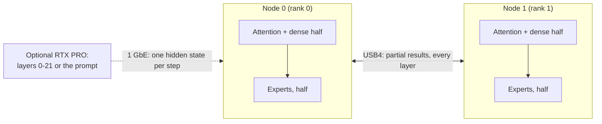

# Dos nodos Strix Halo por USB4

[English](pair.md) · [Español](pair.es.md) · [README principal](../README.es.md)

El par son dos mini PC Strix Halo unidos por dos cables USB4 directos (un enlace de 40 Gb/s y otro de 20 Gb/s),
gobernados por nuestra [serie de parches del driver USB4](https://github.com/hyukudan/strix-halo-usb4-driver): unos
37 Gb/s por dirección con ambas direcciones ocupadas, 18.4 µs para un intercambio de 20 KB. El comunicador de dos ranks
propio del motor transporta los intercambios de cada capa; no hay ningún gestor de clúster en la ruta de inferencia.
Tres motores se ejecutan en él en Production:

| Motor | División | Página |
|---|---|---|
| DeepSeek V4.1 Flash | decode con paralelismo tensorial de expertos (cada nodo contiene la mitad de los expertos enrutados y la mitad de cada proyección densa con paralelismo tensorial), prefill en dispositivo con paralelismo de expertos, DSpark, decode por batch, servidor HTTP; opcionalmente una RTX PRO 6000 para las capas 0-21 por 1 GbE | [DeepSeek](models/deepseek-v4.1/README.es.md) |
| MiniMax M3.1 Flash | TP2 sobre USB4, prefill y decode exactos, servicio DSpark con admisión automática | [MiniMax](models/minimax-m3.1/README.es.md) |
| GLM-5.3 Flash | TP2 sobre USB4, prefill exacto por chunks, autoespeculación MTP exacta | [GLM](models/glm-5.3/README.es.md) |

Qwen no divide una petición entre los nodos (medido y rechazado, X-021 en el
[registro de decisiones](decisions/decision-register.md#measured-and-rejected)); ejecuta una réplica completa por
nodo tras el router [TensorMeld](https://github.com/hyukudan/tensormeld) (véase la
[página de Qwen](models/qwen3.8/README.es.md)).

## Cómo se ejecuta DeepSeek en dos nodos

**DeepSeek en dos nodos.** Cada nodo contiene la mitad de los expertos enrutados y la mitad de cada proyección densa con
paralelismo tensorial. En cada capa, las dos GPU intercambian pequeños resultados parciales por USB4 (cuatro flujos de host sobre los dos cables);
el prompt se lee con paralelismo de expertos y el estado de atención se reparte entre los nodos.

## Qué necesita el par

Dos nodos Strix Halo con 128 GB cada uno, dos cables USB4 directos, la serie del driver USB4 y, para MiniMax y GLM, la
biblioteca trellis; la tabla completa de requisitos está en [primeros pasos](getting-started/README.es.md#what-you-need).
Configure y compile ambos ranks de forma idéntica, ejecute el mismo perfil en ambos y deles los mismos assets.
Para DeepSeek, [`scripts/pair/ds41-pair`](pair-setup.es.md) hace todo esto desde un checkout limpio: comprobación
previa, controlador, compilación, pesos verificados, arranque y una prueba exacta.

La configuración del kernel/IOMMU corresponde al propietario de la máquina. Mantenga traducidos los controladores USB4; nunca desactive
el IOMMU para ganar velocidad. Registre el kernel en ejecución y `amdgpu.iommu_perfopt` en los recibos de tiempos y compare
PerfOpt activado/desactivado solo con el mismo kernel.

## Lanzamiento, orquestación y medición

- Comandos de lanzamiento por motor: [par DeepSeek](models/deepseek-v4.1/README.es.md#deepseek-pair),
  [par MiniMax](models/minimax-m3.1/README.es.md#minimax-pair), [par GLM](models/glm-5.3/README.es.md#glm-pair).
- Orquestación y desmontaje del par para benchmarks: [reproducción](reproduce.md#pair-orchestration-and-teardown).
- Cifras medidas del enlace: [rendimiento, el enlace USB4](performance.md#the-usb4-link).
- Internos del transporte: [comunicador de dos ranks](engine/transport/communicator.md),
  [transporte GPU directo por USB4](architecture/16-direct-gpu-transport.md),
  [arquitectura multinodo y USB4](architecture/12-multi-node-and-usb4.md),
  [recuperación del controlador USB4](engine/transport/usb4-controller-recovery.md).
- Valores predeterminados de transporte e intercambio de prefill de DeepSeek:
  [valores predeterminados de producción](models/deepseek-v4.1/production-defaults.md),
  [contextos largos en dos nodos](models/deepseek-v4.1/long-context.md).
