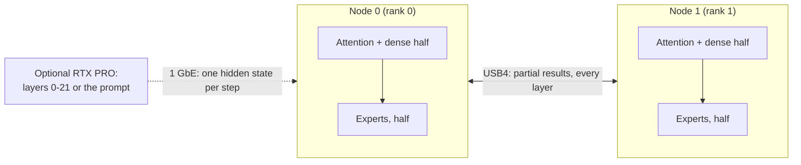

# Two Strix Halo nodes over USB4

[English](pair.md) · [Español](pair.es.md) · [Main README](../README.md)

The pair is two Strix Halo mini PCs joined by two direct USB4 cables (one 40 Gb/s and one 20 Gb/s link), driven by our
[USB4 driver series](https://github.com/hyukudan/strix-halo-usb4-driver): about 37 Gb/s per direction with both
directions busy, 18.4 µs for a 20 KB exchange. The engine's own two-rank communicator carries the per-layer exchanges;
there is no cluster manager in the inference path. Three engines run on it in Production:

| Engine | Split | Page |
|---|---|---|
| DeepSeek V4.1 Flash | expert tensor parallel decode (each node holds half of the routed experts and half of each tensor-parallel dense projection), expert parallel device prefill, DSpark, batched decode, HTTP server; optionally an RTX PRO 6000 for layers 0-21 over 1 GbE | [DeepSeek](models/deepseek-v4.1/README.md) |
| MiniMax M3.1 Flash | TP2 over USB4, exact prefill and decode, DSpark serving with automatic admission | [MiniMax](models/minimax-m3.1/README.md) |
| GLM-5.3 Flash | TP2 over USB4, exact chunked prefill, exact MTP self-speculation | [GLM](models/glm-5.3/README.md) |

Qwen does not split one request across the nodes (measured and rejected, X-021 in the
[decision register](decisions/decision-register.md#measured-and-rejected)); it runs one complete replica per node
behind the [TensorMeld](https://github.com/hyukudan/tensormeld) router (see the [Qwen page](models/qwen3.8/README.md)).

## How DeepSeek runs on two nodes

**DeepSeek on two nodes.** Each node holds half of the routed experts and half of each tensor-parallel dense
projection. Per layer, the two GPUs exchange small partial results over USB4 (four host streams over the two cables);
the prompt is read expert parallel, and the attention state is split between the nodes.

## What the pair needs

Two Strix Halo nodes with 128 GB each, two direct USB4 cables, the USB4 driver series, and for MiniMax and GLM the
trellis library; the full requirement table is in [getting started](getting-started/README.md#what-you-need).
Configure and build both ranks identically, run the same profile on both ranks, and give both the same assets.
For DeepSeek, [`scripts/pair/ds41-pair`](pair-setup.md) does all of this from a fresh checkout: preflight, driver,
build, verified weights, launch and an exact smoke test.

Kernel/IOMMU settings belong to the machine owner. Keep USB4 controllers translated; never disable
IOMMU for speed. Record the running kernel and `amdgpu.iommu_perfopt` in timing receipts and compare
PerfOpt on/off only on the same kernel.

## Launch, orchestration and measurement

- Launch commands per engine: [DeepSeek pair](models/deepseek-v4.1/README.md#deepseek-pair),
  [MiniMax pair](models/minimax-m3.1/README.md#minimax-pair), [GLM pair](models/glm-5.3/README.md#glm-pair).
- Pair orchestration and teardown for benchmarks: [reproduce](reproduce.md#pair-orchestration-and-teardown).
- Measured link figures: [performance, the USB4 link](performance.md#the-usb4-link).
- Transport internals: [two-rank communicator](engine/transport/communicator.md),
  [direct GPU transport over USB4](architecture/16-direct-gpu-transport.md),
  [multi-node and USB4 architecture](architecture/12-multi-node-and-usb4.md),
  [USB4 controller recovery](engine/transport/usb4-controller-recovery.md).
- DeepSeek transport and prefill exchange defaults: [production defaults](models/deepseek-v4.1/production-defaults.md),
  [long contexts on two nodes](models/deepseek-v4.1/long-context.md).
